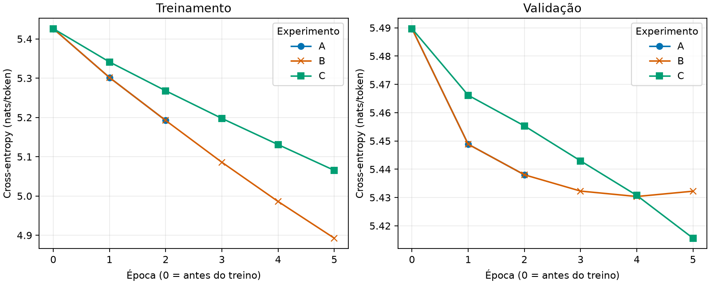

# Sprint 5 — Treinamento, avaliação e geração do GPT

## Objetivo e arquitetura

A Sprint 5 treina o GPT *decoder-only* da Sprint 4 para prever o próximo token de um corpus sem rótulos. O modelo combina embeddings aprendíveis de token e posição, atenção causal multi-head da Sprint 3 e blocos Transformer pre-LayerNorm da Sprint 4. A projeção final gera logits `[B,T,V]` para o vocabulário em cada posição. O corpus, o tokenizador e os pares de entrada e alvo vêm do fluxo da Sprint 2. O treinamento segue o objetivo de pré-treino do Capítulo 5 de *Build a Large Language Model (From Scratch)*. [Arquitetura da Sprint 4](sprint4_arquitetura.md) · [Código do Capítulo 5](https://github.com/rasbt/LLMs-from-scratch/tree/main/ch05)

| Arquivo | Função |
| --- | --- |
| `src/training.py` | Prepara os dados, inicializa o GPT, treina com AdamW e registra o histórico. |
| `src/evaluation.py` | Calcula entropia cruzada e perplexidade em treino e validação. |
| `src/generation.py` | Reutiliza o laço autoregressivo e compara greedy, temperatura e top-k. |
| `src/checkpoint.py` | Salva e carrega pesos, arquitetura, vocabulário e metadados de treino. |
| `experimentos/sprint5_experimentos.py` | Executa A, B e C e grava métricas, curvas e textos. |
| `tests/test_sprint5.py` | Verifica métricas, treinamento, amostragem e equivalência do checkpoint. |
| `docs/glossario.md` | Reúne as definições dos conceitos do Capítulo 5. |

## Protocolo de treinamento e avaliação

O corpus `data/texto_teste.txt` foi dividido em um primeiro trecho com 292 palavras delimitadas por espaços e um trecho final com 73, uma proporção de 80/20. A divisão antecede a tokenização e a criação das janelas. O `SimpleTokenizerV2` constrói o vocabulário apenas com o trecho de treino e mapeia palavras desconhecidas para `<|unk|>`. Os trechos resultam em 334 e 82 tokens, respectivamente.

O contexto tem 12 tokens. O DataLoader de treino usa passo 4 para formar 81 janelas e embaralha a ordem delas em cada época. Os DataLoaders de avaliação usam passo 12, lotes de até 8 janelas e ordem fixa. Assim, cada posição-alvo avaliada entra uma vez na média. Há 27 janelas de treino e 6 de validação. O dataset usa janelas completas e o DataLoader inclui lotes parciais.

O alvo de cada posição é o token imediatamente seguinte no corpus. Para a entropia cruzada, o código reorganiza os logits `[B,T,V]` em `[B*T,V]` e os alvos `[B,T]` em `[B*T]`. O PyTorch calcula a perda diretamente a partir dos logits. A avaliação desativa dropout com `model.eval()`, roda em `torch.no_grad()` e restaura o modo anterior ao terminar. A perda média é ponderada pelo número de tokens de cada lote, e a perplexidade é `exp(perda média)`. As métricas são medidas antes da primeira atualização (época 0) e ao fim de cada época. [Documentação de CrossEntropyLoss](https://docs.pytorch.org/docs/stable/generated/torch.nn.CrossEntropyLoss.html)

Os três experimentos usam o mesmo GPT de 37.312 parâmetros treináveis, vocabulário de 182 tokens, embeddings de dimensão 32, dois blocos, quatro heads de atenção, FeedForward de dimensão 128, dropout de 0,1 e projeções Q/K/V sem bias. Cada execução inicializa o modelo com a semente 123 e cria um novo AdamW com taxa de aprendizado `0.0004` e `weight_decay=0.01`. O embaralhamento dos lotes tem seu próprio gerador com semente 123.

## Como reproduzir

Execute os comandos na raiz do repositório com Python 3.12. PyTorch e Matplotlib são usados pelo treino e pelos experimentos, e pytest executa a suíte de testes. As dependências já constam em `requirements.txt`.

```bash
python -m pip install -r requirements.txt
python -m pytest -q
python -m experimentos.sprint5_experimentos --device cpu
```

O script grava os CSVs, o gráfico e as amostras em `experimentos/resultados_sprint5/`, com os pesos locais em `checkpoints/{A,B,C}.pt`. Para executar somente C e manter os resultados da comparação, use outro diretório de saída.

```bash
python -m experimentos.sprint5_experimentos --experiments C --device cpu --output-dir experimentos/resultado_C
```

Para treinar, avaliar e gerar texto com uma configuração própria, use os módulos abaixo. Se `--device` for omitido, os comandos escolhem CUDA quando disponível e CPU nos demais casos. A avaliação refaz a divisão registrada e confere a identidade do corpus pelo SHA-256. Informe o mesmo `--data` nos comandos de treino e avaliação ao usar um corpus alternativo.

```bash
python -m src.training --epochs 5 --batch-size 4 --learning-rate 0.0004 --device cpu
python -m src.evaluation --checkpoint experimentos/treino_sprint5/modelo.pt --device cpu
python -m src.generation --checkpoint experimentos/treino_sprint5/modelo.pt --prompt "Um modelo de linguagem" --max-new-tokens 20 --temperature 1.2 --top-k 5 --seed 123 --device cpu
```

O treinamento salva `modelo.pt` e `historico.csv` no diretório de saída. `save_checkpoint` usa `torch.save()` para persistir o `state_dict`, a configuração do GPT, o mapa token–ID e os hiperparâmetros. `load_checkpoint` usa `torch.load(..., weights_only=True)` e devolve o modelo em avaliação, o tokenizador e os metadados. O GPT carregado pode gerar texto imediatamente. A época e o `optimizer_state_dict` permitem reconstruir o AdamW para continuar o treino programaticamente. Os arquivos `.pt` são ignorados pelo Git. [Serialização no PyTorch](https://docs.pytorch.org/docs/stable/notes/serialization.html)

## Resultados dos experimentos

A execução foi feita no Windows com Intel Core i5-7400, uma thread de CPU, Python 3.12.14, PyTorch 2.15.0+cpu e Matplotlib 3.11.2. Os três modelos partiram de perda de **5,4261** no treino e **5,4897** na validação, com perplexidades de **227,27** e **242,19**, respectivamente.

| Experimento | Épocas | Lote | Atualizações | Perda final de treino | Perda final de validação | Perplexidade final de treino | Perplexidade final de validação |
| --- | ---: | ---: | ---: | ---: | ---: | ---: | ---: |
| A | 2 | 4 | 42 | 5,1923 | 5,4380 | 179,88 | 229,99 |
| B | 5 | 4 | 105 | **4,8926** | 5,4322 | **133,29** | 228,66 |
| C | 5 | 8 | 55 | 5,0652 | **5,4156** | 158,41 | **224,89** |

O tempo de cada execução é registrado em segundos, da avaliação inicial até o fim da última época, antes de salvar o checkpoint. Os valores descrevem uma única execução local. [Configurações, métricas iniciais e finais e tempos (CSV)](../experimentos/resultados_sprint5/experimentos.csv) · [Histórico por época (CSV)](../experimentos/resultados_sprint5/historico.csv)



Os pontos de A e B coincidem até a época 2, pois ambos seguem a mesma configuração nesse intervalo. Os painéis usam escalas verticais próprias para mostrar a evolução da validação. B terminou com a menor perda de treino e apresentou um possível sinal de sobreajuste entre as épocas 4 e 5. Nesse intervalo, a perda de treino caiu de 4,9860 para 4,8926 e a de validação subiu de 5,4304 para 5,4322.

C obteve a menor perda de validação ao fim da quinta época, com 55 atualizações frente às 105 de B. A comparação de lotes a um número fixo de épocas envolve tanto o tamanho do lote quanto a frequência de atualização. Com uma única divisão do corpus e uma única semente, a pequena diferença de validação observada entre B e C é específica deste ensaio.

## Geração de texto

As três estratégias usam os mesmos pesos do checkpoint e mudam a seleção do próximo token. Greedy escolhe o maior logit. Temperature Sampling usa `softmax(logits / T)` para sortear no vocabulário. Top-k limita o sorteio aos `k` maiores logits. O GPT recebe apenas os 12 tokens mais recentes quando a sequência ultrapassa a janela de contexto.

As amostras abaixo foram produzidas com o checkpoint B, o prompt `Um modelo de linguagem` e 20 novos tokens por estratégia. As duas amostragens usam a semente 123.

| Estratégia | Texto gerado |
| --- | --- |
| Greedy Decoding | Um modelo de linguagem próximo. da determina Para. da determina Na explícita e. da frente mudar identidade e. da frente |
| Temperature Sampling (`T=1.2`) | Um modelo de linguagem. o dados Esses diferentes resultado Por identidade entre identificador enquanto apenas essa parâmetros da frente Os paralelo posições seguinte |
| Top-k Sampling (`k=5`, `T=1`) | Um modelo de linguagem próximo determina cada determina neural.. carregar parâmetros ao lotes Antes ao Depois frente frente. mudar convertidos rede |

Greedy produziu 11 tokens distintos entre os 20 novos e repetiu trechos como `da determina`. Temperature Sampling produziu 20 tokens distintos, com maior variedade lexical e pouca continuidade sintática. Top-k produziu 15, preservou palavras relacionadas ao corpus e repetiu `determina` e `frente`. As amostras mostram diferenças de diversidade e repetição, com coerência limitada nas três estratégias. [Amostras completas de A, B e C](../experimentos/resultados_sprint5/amostras.txt)

## Limitações e conclusão

O corpus tem 416 tokens e trata de um único assunto. A validação cobre 72 posições-alvo, das quais 32 (44,4%) são mapeadas para `<|unk|>`. Isso limita a interpretação da perplexidade e torna as métricas dependentes desse vocabulário. O contexto de 12 tokens e o treinamento breve também limitam a continuidade das amostras.

Os três experimentos reduziram a perda de validação em relação aos pesos iniciais. A queda foi mais pronunciada no treino, e o resultado de B entre as duas últimas épocas ilustra como a avaliação por época ajuda a identificar quando o ajuste ao corpus de treino pode deixar de beneficiar a validação.
